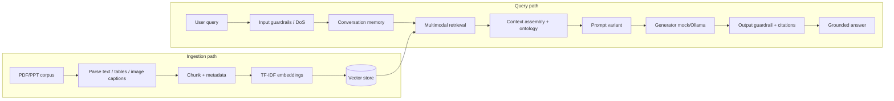

# Part A — High-Level Design (HLD)

## Anchor

- **Domain:** Synthetic Warehouse Execution System (WES) operations handbook  
- **Users:** Warehouse operations analyst / floor supervisor  
- **Why retrieval:** SOPs, tables and diagrams change often; RAG avoids fine-tuning and keeps answers cited.

## Components

## Constraint → design mapping

| Constraint | Design decision |
|------------|-----------------|
| FR1 ≥100 docs | Synthetic corpus builder (`corpus_builder.py`) emits 110 PDFs |
| FR2 text/table/image searchable | Modality-tagged elements; image pages store diagram captions |
| FR3 P95 &lt; 90s | Local TF-IDF + mock/Ollama; measured in E5/E6 |
| FR4 guardrail overhead &lt; 6s | Regex/heuristic guards timed separately |
| FR5 self-improving prompts | E8 critique-and-rewrite loop with dev/held split |
| NFR1 consistency | Temperature 0 / deterministic mock; 5-run checks |
| NFR2 token efficiency | Chunked evidence vs naive whole-doc baseline in ablation |

## Data flow summary

1. **Ingest:** PDF → page text → modality split → chunks + ontology fields.  
2. **Index:** TF-IDF matrix persisted under `data/index/`.  
3. **Query:** rewrite follow-ups → retrieve top-k → render prompt → generate → validate citations.
