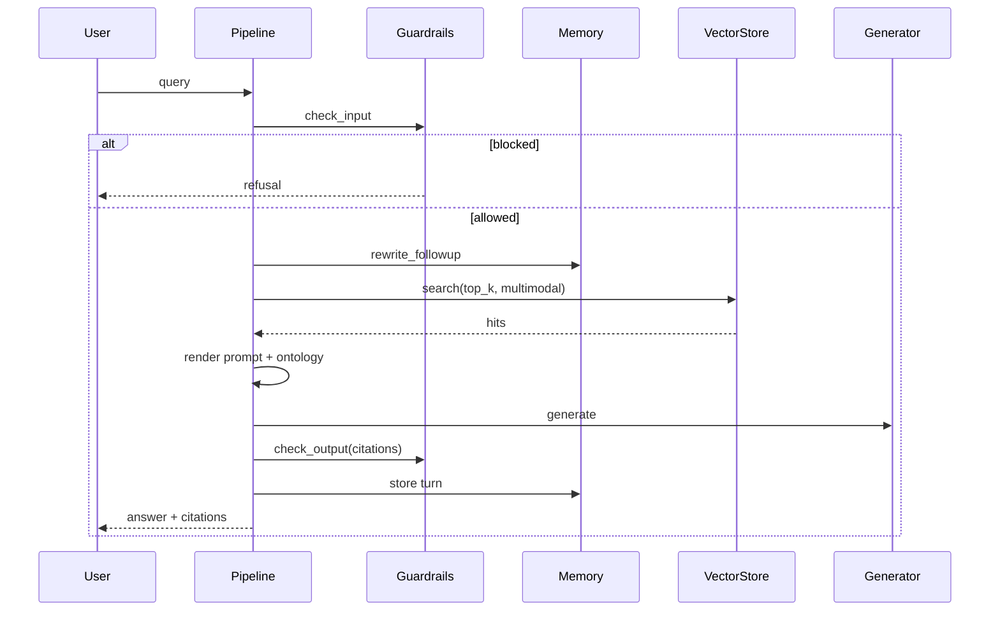

# Part A — Low-Level Design (LLD)

## Modules

| Module | Responsibility |
|--------|----------------|
| `corpus_builder.py` | Deterministic synthetic PDF generation (seed 42) |
| `ingest.py` | PDF text extraction; modality split (text/table/image) |
| `chunking.py` | Sliding-window chunks; E2 size/overlap comparison |
| `embeddings.py` | TF-IDF fit/transform + persistence |
| `vector_store.py` | Cosine retrieval with modality/topic filters |
| `memory.py` | Short-term turn buffer + follow-up rewrite |
| `guardrails.py` | Injection / PII / OOS input checks; citation output checks |
| `prompts.py` | zero_shot, f_string, three_shot, jinja2, react |
| `prompt_optimize.py` | Self-improve iterations (E8) |
| `generate.py` | `mock` (default) or `ollama` backend |
| `pipeline.py` | End-to-end query orchestration |
| `evaluate.py` | Golden metrics, ablation, failures, auto-eval proxy |

## Metadata schema (chunk)

```json
{
  "chunk_id": "WES-PUT-000-p1-text-0",
  "doc_id": "WES-PUT-000",
  "source": "WES-PUT-000.pdf",
  "page": 1,
  "modality": "text|table|image",
  "document_type": "sop|guide|...",
  "topic": "put_wall|...",
  "section": "body|reference_table|diagram",
  "text": "...",
  "sensitivity": "public_synthetic"
}
```

## Query sequence



## Error handling

- Missing corpus → run `scripts/run_part_a.py` (builds corpus).  
- Empty retrieval → generator returns insufficient-evidence; output guardrail may refuse.  
- Ollama down → automatic fallback to `mock` backend.  
- Injection / OOS / PII → hard block with reason code.
